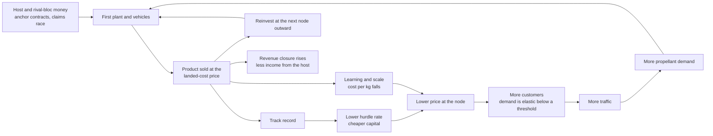

# Intercept Window: Early Economy – Revenue Streams and the Growth Loop

Nov 4, 2026 · proposal

Why a company goes out there at all, what actually pays in the first decades, and the feedback loop that turns a loss-making charter into an empire. Figures marked *(calc)* were computed for this doc; everything else is sourced at the end.

## The short version

- **Mining for Earth is the worst early business; selling to space is the best.** The value of a kilogram depends on where it is. Hydrazine delivered in GEO is priced at about $200,000/kg, roughly three times platinum on Earth *(calc)*. Water in the right orbit beats precious metal on the ground.
- **Today's money is near Earth and mostly not physical.** The 2025 space economy was $686B, 79 % commercial, and most of that is satellite services and ground equipment. Launch is about 2 %. Nothing mined in space has ever been sold beyond gram-scale samples.
- **The first asteroid miners died of one thing: no revenue before the mine.** Planetary Resources and Deep Space Industries both failed to raise their next round and were sold to non-space buyers. The Virginia Company is the same story 400 years earlier: no gold, investors lost nearly everything, and the colony was saved by tobacco, a product nobody had pitched.
- **Early money is strategic, not commercial.** Governments pay above market for capability, precedent and security: NASA's COTS deal, the $1 lunar regolith purchase, the Air Force buying reentry capsules, the DOE buying lunar helium-3 that doesn't exist yet. In the game, the **host is the anchor customer**, and that is the money side of the dependency curve.
- **The loop:** anchor contract → first plant → track record → cheaper capital → cheaper product → more customers → more traffic → more propellant demand → next node outward. Cost of capital is the hidden master variable: in Metzger's lunar-propellant model, finance is about 82 % of the first year's cost.
- **Mining enters in a fixed physical order, not a scripted one:** volatiles and propellant for in-space customers first, structure for in-space building second, niche high-value goods alongside, bulk exports to Earth last. A large metal return crashes the price it was counting on.
- **Revenue closure mirrors closure.** The share of the company's income that doesn't come from the host is as much a measure of independence as the share of its bill it can make itself. A company that sells only to its sponsor can be embargoed without a single warship.
- **Proposal:** no "mining income" button. Money comes from **contracts** (host and others) and **markets at places**, priced by a **landed-cost price field**: the ceiling price of any good at any node is the delivered cost of its cheapest alternative source. Investors are a constituency with a hurdle rate and limited patience.

## What pays in space today (late 2026)

Almost all space revenue is bits sent to Earth, not atoms. That's the honest starting point: an early company earns its keep by serving what's already in orbit, and by being paid for strategic reasons.

| Segment | Size | Who pays | Relevance to the start state |
| --- | --- | --- | --- |
| Whole space economy, 2025 | $686B; $544B commercial (79 %), ~$141B government | — | The pool a company competes for capital in |
| Satellite-enabled products and services | ~$386B, 71 % of commercial | Consumers, businesses, militaries | Bits, not atoms. The customer base a servicing company lives off |
| Launch | Commercial launch revenue ~$12.4B in 2025, about 1.8 % of the economy *(calc)* | Satellite operators, governments | The enabler, and the price every in-space product competes against |
| Starlink vs. launch at SpaceX | $11.4B vs. $4.1B in 2025 | Subscribers vs. payload owners | The best real example of being your own customer (below) |
| Government space budgets | ~$141B across 53 budgets, majority defence | States | The anchor money in every early-game case below |
| In-space servicing and refuelling | Contracts of ~$10–20M per job (MEV, Orbit Fab) | GEO operators, the Space Force | First physical service sold in space |
| Space resources | Forward contracts only (helium-3); token purchases (regolith) | Quantum-cryogenics firms, DOE, NASA | Nothing delivered yet |

The Space Foundation added a separate **lunar activities** sector to its 2026 report, which says something about where analysts expect money to appear next.

**Being your own customer.** SpaceX's launch business funded Starlink, and Starlink now funds Starship. By 2025 Starlink was about 60 % of SpaceX revenue, and SpaceX increasingly reserves its own launch capacity for its own satellites. That's the strongest real-world loop in the industry: cheap transport creates its own demand when the transporter also owns the payload. For the game it means a company's own expansion is often the first big customer of its own depot.

## The first asteroid-mining bubble and why it burst

| Company | Years | What happened | Lesson |
| --- | --- | --- | --- |
| Planetary Resources | 2012–2018 | Backed by prominent tech investors; flew test satellites; failed to close a funding round in 2018, laid off staff, sold to a blockchain company | Ran out of runway with no interim revenue |
| Deep Space Industries | 2013–2019 | Raised far less; drifted into small-satellite propulsion (water thrusters) and was sold to Bradford Space | Pivoted to the product with real customers, too late |
| AstroForge | 2022– | Two lost missions (Brokkr-1 2023, Odin 2025); DeepSpace-2 built for under $10.5M, riding with IM-3, targeted for late 2026 | A cheaper second try, still pre-revenue |
| TransAstra, Karman+, Interlune | 2020s | Keep other revenue lines alive (TransAstra), sell water to satellites (Karman+), separate helium-3 from terrestrial gas as a bridge (Interlune) | **Bridge revenue** is now the standard pattern |

Former staff of the first wave blamed the lack of any infrastructure for an industry to plug into, and the crowd of other space ventures competing for the same capital. Both first-wave companies had concluded that their first product would be water as propellant, not metal.

**The 1607 version.** The Virginia Company was chartered to find gold and turn a profit. It found no gold; by 1616 its profits were so small it paid its dividend in Virginia land instead; by 1618 its £75,000 had been almost entirely lost; it was dissolved when Virginia became a royal colony. Meanwhile John Rolfe's sweeter tobacco, grown from about 1612, became the colony's economic base. Three lessons for the game:

- **The product that saves a colony is rarely the one in the prospectus.** Let the price field discover it.
- **The company can lose while the colony wins.** Investors and colonists are different constituencies with different timelines.
- **Paying dividends in land is paying in claims.** Claims are a currency before there is revenue (see "Claims and option value" below).

## Why metals for Earth are the worst business

Platinum is the usual pitch, and it shows the problem cleanly.

- **The market is small.** Total 2025 platinum supply was about 7.13 Moz, about 222 t, of which mining was about 171 t *(calc from Moz)*. At the end-2025 price of about $2,070/oz that's roughly $66,500/kg, and the whole year's supply is worth about $15B *(calc)*.
- **It is inelastic in the short run.** The World Platinum Investment Council's view is that both supply and demand barely respond to price in the short term, which is why deficits persist.
- **A big return crashes its own price.** A single 100 t delivery is 45 % of a year's supply *(calc)*. With an assumed short-run demand elasticity of 0.3–0.5, the price falls to 29–48 % of where it was, and the cargo fetches $1.9–3.2B instead of the naive $6.7B *(calc, elasticity assumed)*.
- **Trickling helps but caps revenue.** 20 t a year (9 % of supply) holds the price at 75–84 % and earns about $1.0–1.1B a year *(calc, same elasticities)*.
- **The long run is better, slowly.** A 2026 system-dynamics study of AstroForge's case finds the price eventually falls toward the asteroid miner's cost, but only after supply has shifted. Cheap platinum would find new uses (catalysts, fuel cells), so long-run demand is more elastic than short-run.

**For the game:** every Earth market gets a demand curve with a short-run and a long-run elasticity. A player who dumps a metal asteroid on Earth learns why the miners didn't. And the people who own Earth's mines are a constituency in the host's politics, lobbying against the import.

## The value of a kilogram depends on where it is

This is the central fact of space economics, and the mechanic the rest of the doc builds on. Prices are set by what it would cost to get the same thing there another way.

| Good, place | Price | Note |
| --- | --- | --- |
| Platinum, Earth | ~$66,500/kg | End-2025 price *(calc)* |
| Hydrazine, delivered in GEO | $20M for up to 100 kg, so ~$200,000/kg *(calc)* | Orbit Fab's posted price; the client needs a $30,000 refuelling port |
| Propellant, LEO (bid) | $3,000/kg (one paper reports $3,000–7,000) | United Launch Alliance's 2016 offer to buy |
| Propellant, Earth–Moon L1 (bid) | $1,000/kg | Same offer |
| Propellant, lunar surface (bid) | $500/kg | Same offer: low because the seller still has to lift it |
| Lunar propellant, near-term market | 450 t a year for $2.4B, so ~$5,300/kg *(calc)* | Kornuta et al. 2019 demand estimate |
| GEO life extension | ~$13M a year per satellite | Intelsat's filings for MEV-1; comsats cost $150–300M |
| Helium-3, Earth | ~$2,000–20,000 per litre; ~$19–150M/kg *(calc, 0.135 g/L)* | Earth makes 22,000–30,000 L a year, about 3–4 kg *(calc)* |
| Launch, LEO | Falcon Heavy ~$1,520/kg (2022 list); Falcon 9 ~$74M a launch (2026) | Starship's targets would push this down by an order of magnitude or more |
| Space-based solar power, delivered | $0.61–1.59/kWh baseline, against $0.02–0.05 terrestrial | NASA OTPS 2024; launch is 71–77 % of the cost |

Three readings:

- **Fuel where it's needed is worth more than metal on the ground.** The hydrazine price is mostly the value of the satellite it keeps alive, not the molecule.
- **Lunar propellant wins from the Moon outward, then creeps inward.** Metzger's 2023 model finds that lunar propellant beats Earth-launched propellant at the lunar surface, low lunar orbit and L1 from the first year; at GEO by year 2; at GTO by years 6–7; and at LEO only after about 19–23 years, even as Earth launch gets cheaper. **The frontier of advantage moves toward Earth over time.** That's a map the player can watch.
- **Earth exports are the long dream, not the first step.** Space solar power is 12–80 times too expensive in NASA's baseline and becomes competitive only if launch cost, cell efficiency, servicing, hardware life and learning all improve together.

### Comparative, not absolute, advantage

Metzger makes a point games usually miss: lunar propellant doesn't have to be cheaper than Earth propellant, only cheaper than **the payload Earth launch could have carried instead**. When launch capacity is scarce, every tonne of propellant lifted is a tonne of satellites not lifted. SpaceX now prioritises its own payloads, which makes this real today. **In the game, Earth launch capacity is a rationed resource, and the host allocates its slots.** That's leverage of its own.

## Who pays first: anchor customers

Before markets exist, states buy capability, precedent and security. Every real early-space business on this list began with a government cheque.

| Anchor | What was bought | Price | What it really bought |
| --- | --- | --- | --- |
| NASA COTS (2006–) | Cargo-delivery capability, paid by milestone | Falcon 1 and 9 together cost ~$390M to develop, against a $1.7–4B estimate for a traditional approach | A new industry, at a fraction of the usual cost, with fixed-price risk on the contractor |
| NASA regolith purchase (2020) | A little lunar regolith, collected and photographed in place | $1 to $15,000 per contract; $25,001 for all four | **A legal precedent:** private extraction and sale under the Outer Space Treaty |
| AFRL → Varda (2024–) | Hypersonic test flights on reentry capsules | $48M over four years | The capsule business's actual revenue while pharmaceuticals mature |
| DOE Isotope Program → Interlune (2025) | Helium-3 for national labs | Undisclosed | A first government customer before any lunar hardware flies |
| DoD → Orbit Fab | Refuelling ports on military satellites | >$21M in contracts | A standard, and a market, seeded by the military |

**Why anchors matter so much: the cost of capital.** In Metzger's model of lunar propellant, finance is 82 % of the cost in year 1 and still 73 % in year 30. His baseline assumes investors demand 21.7 % a year at first; a public–private partnership at 12 % brings the date when lunar propellant wins in GTO forward by years. The single biggest thing a government can do isn't to buy the propellant; it's to **take part of the risk**, which makes everyone else's money cheaper.

**The geopolitics behind the cheque.** The money flows because blocs compete. The US-led Artemis Accords passed 75 signatories in September 2026, against the China–Russia lunar station coalition; the Accords let signatories claim the resources they extract, which critics say conflicts with the Outer Space Treaty's ban on appropriation. A host sponsors a company because its rival bloc is doing the same: that's the early game's real engine.

## Claims and option value

Before revenue, a company can still hold assets that investors will pay for:

- **Claims on scarce sites.** The lunar south pole has a few ice-filled cold traps next to a few nearly always-lit ridges (tension 4 in [`studies/solar-resources/07-gamification-notes.md`](../studies/solar-resources/07-gamification-notes.md)). Occupying one first, with "safety zones" recognised by a bloc's rules, is worth money long before the ice is.
- **Prospecting data.** Drill logs are property already ([`design/resource-fields-grades-and-yield-curves.md`](resource-fields-grades-and-yield-curves.md)). A proven deposit raises a company's value and lowers its hurdle rate; a dry hole does the opposite.
- **Demonstrated reliability.** Metzger et al.'s "minimum viable product" mine was designed to produce a little revenue fast; as Metzger later described it, its most important product was investor optimism, which buys the next, bigger round.

All three are **option value**: they pay only if someone eventually builds on them, which is exactly how a speculative charter was financed in 1607 and in 2012.

## The early revenue ladder

Each rung is a different buyer at a different place. Rungs overlap; a company climbs whichever its location, ships and host allow.

| Rung | What's sold | Buyer | Where | Why it pays early | Game hook |
| --- | --- | --- | --- | --- | --- |
| **0. Anchor contracts** | Development milestones, cargo, landers, sample return, test flights, prospecting surveys | The host; rival blocs | Anywhere the host wants a flag | Strategic value; risk-sharing lowers the company's cost of capital | Contracts come with clauses: priority, data rights, export control, "host-built drive" |
| **1. Services to Earth-orbit assets** | Life extension, refuelling, relocation, inspection, debris removal | Satellite operators, militaries | GEO first (one orbit, rich clients), then LEO | Sells the time of a $150–300M asset; no new market needed | **Every servicer is an anti-satellite weapon.** The host licenses them like drives |
| **2. Niche high-value goods** | Helium-3, microgravity crystals, isotopes | Cryogenics, pharma, national labs | Earth | Millions of dollars per kg | **Tiny, saturating markets.** Helium-3 for quantum cooling is kilograms a year |
| **3. Propellant and volatiles** | Water, LOX, LH₂, hydrazine, later methane | Every ship passing the node, including the company's own | L1, NRHO, lunar orbit, GEO, then the belt hubs | Landed-cost advantage from the Moon outward | Grows with traffic: the main self-reinforcing loop |
| **4. Construction mass** | Shielding, structure, tanks, regolith blocks | Yards, stations, habitats | Lunar orbit, L1, later Mars orbit and Ceres | Replaces launched mass in bulk | Feeds the shipyard of the logistics doc |
| **5. Information** | Space situational awareness, tracking, imagery, the polity's picture as a service | Governments, operators, insurers | Wherever the company has sensors | Sensors are dual-use; the picture is valuable to others | Selling the picture leaks it ([`design/detection-and-the-picture.md`](detection-and-the-picture.md)) |
| **6. Exports to Earth** | Metals, PGMs, energy | Earth markets | Earth | Big markets, but thin per good and deep in the well | Last, and politically opposed by Earth's own producers |

Two notes on specific rungs:

- **Helium-3 is a perfect early-game trap.** Bluefors agreed to buy up to 10,000 litres a year for 2028–2037, a deal reported above $300M, which is at least $3,000 a litre if fully taken *(calc)*. But 10,000 L is only about 1.35 kg, and at 10 ppb in regolith each kg means digging about 100,000 t before recovery losses *(calc)*. It's a real, high-margin niche whose price collapses if the player oversupplies it, unless quantum computing or fusion grows the market. Interlune's bridge is separating helium-3 from terrestrial gas while the lunar plant is built.
- **Servicing is the same skill set as inspection and interception.** Rendezvous, docking, holding station alongside a client: the inspection knife fights of the design notes. A company that earns its living extending satellite lives has, without trying, the fleet the host fears most near Earth. That's the theme "every industrial tool is a weapon" in its earliest form.

## The growth loop

**What turns each arrow, physically:**

- **Track record → cheaper capital.** Each year of delivered product lowers the risk premium investors demand. A failed mission, anyone's, raises it across the sector: AstroForge's investors still remember Planetary Resources.
- **Learning and scale.** Wright's-law learning rates of 0.75–0.8 per doubling of output, and economies of scale with an exponent near 0.6, are Metzger's working values. Two doublings at 0.75 cut cost to 56 % *(calc)*.
- **Elastic demand.** Space transport demand appears to become elastic only below roughly $2,200–6,100/kg to LEO (in 2022 dollars, depending on the study), with elasticities of 1.5–2.5 assumed in the literature. At an elasticity of 2, halving the price doubles revenue *(calc)*. Above the threshold, cutting prices just loses money. **The threshold is the early game's wall.**
- **Network effects.** Every depot makes every route beyond it cheaper, because ships buy propellant there instead of carrying it. A company that owns the first depot on a route is subsidising its rivals' traffic and taxing it at the same time.
- **Being your own customer.** The company's own tugs, landers and yard are the depot's first steady buyers, as Starlink is Falcon 9's.

**Money is the import term in the growth law.** In [`design/manufacturing-and-the-dependency-ladder.md`](manufacturing-and-the-dependency-ladder.md), plant grows as dP/dt = min(rP, I/v), where I is the vitamin import rate. Early in the game I is set by cash: (revenue − operating cost) ÷ the delivered price of vitamins. So revenue doesn't just buy ships; it sets the ceiling on how fast industry can grow at all, until v falls far enough that the company stops needing Earth's chips.

### The brakes

A loop with no brakes runs away. These come from real economics, not from balancing. They act on individual companies and markets; none of them is allowed to stall the whole world's climb, which the follow-on doc guarantees.

- **Thin markets saturate:** helium-3, platinum, life extension (there are only so many GEO satellites).
- **Earth launch keeps getting cheaper.** Starship-class prices push back the frontier of advantage and lower the ceiling at every inner node.
- **The anchor customer sets terms.** It can cut the price, demand priority, take a revenue share, or cancel the contract as a sanction.
- **Shared sentiment.** One spectacular failure raises every company's hurdle rate, briefly. The rise is capped and decays, so it slows the sector without stopping it (see "Failure is local, the gradient is global" in [`design/from-contracts-to-markets-starting-actors-and-the-transition.md`](from-contracts-to-markets-starting-actors-and-the-transition.md)).
- **Lag on money.** Earth capital acts on light-lagged news (already in [`design/bases-settlements-and-the-civilian-economy.md`](bases-settlements-and-the-civilian-economy.md)).
- **Windows make income seasonal.** Outer-system revenue arrives once per synodic period, so stockpiles of cash matter as much as stockpiles of spares.

## Mining: what, in what order, and why

The order isn't scripted; it falls out of the price field and the four costs of moving a tonne ([`studies/interplanetary-bulk-logistics-mines-depots-and-shipyards.md`](../studies/interplanetary-bulk-logistics-mines-depots-and-shipyards.md)).

| Order | Product | Where from | Sold where | Why it comes in this order |
| --- | --- | --- | --- | --- |
| 1 | Water, then LOX and LH₂ | Lunar polar ice; bagged C-type NEAs | L1, NRHO, lunar orbit, GEO | Highest landed-cost advantage; customers already passing through |
| 1 | Oxygen alone | Any lunar regolith | Lunar surface and orbit | 78–86 % of propellant mass, from any rock; hydrogen is the scarce half |
| 2 | Regolith shielding and crude metal | Lunar regolith (by-product of oxygen plants) | Orbital yards and stations | Replaces launched mass in bulk once a yard exists |
| 2 | Carbon, nitrogen | Carbonaceous NEAs | Lunar yards and habitats | The Moon lacks them; small but essential flows |
| Alongside | Helium-3 | Mature high-Ti mare regolith | Earth | Very high value per kg; kilograms a year saturate the market |
| 3 | Structural metals | NEA metal, lunar Fe-Ti, later Psyche-class bodies | In-space construction | Needs yards and demand off Earth first |
| Last | PGMs and other metals to Earth | M-types | Earth | Thin, inelastic markets deep in the well; opposed by Earth's producers |

**Economy of scope.** Heating regolith for oxygen or ice releases the solar-wind volatiles in it as well (hydrogen, helium, carbon, nitrogen), so one plant can feed several markets. That's a reason a company's first mine can pay from two products at once. Metzger credits the same kind of overlap (ice and metal plants sharing excavation, hauling and heating) with lowering costs over time.

## Model proposal for Intercept Window

### Money and the balance sheet

- **Cash, debt and equity** per polity and firm, on the Routine tier like every other stock.
- **Investors are a constituency** with a **hurdle rate** (the return they demand) and **patience** (how long they'll fund without revenue). Both move with track record, sector news and the host's posture.
- **Funding rounds are events.** A failed round means layoffs and asset sales. For AI companies, being bought is a valid outcome too (Planetary Resources' fate). The player's company is never taken over; its failure is bankruptcy, played through as a reorganisation, not a game over (Rule the Waves' continue-after-defeat; details in [`design/from-contracts-to-markets-starting-actors-and-the-transition.md`](from-contracts-to-markets-starting-actors-and-the-transition.md)).
- **The charter is a financing instrument.** The host grants capital, rights and contracts in exchange for a revenue share, obligations and clauses.

### Markets: goods, places, prices

- **Goods are typed:** propellants (as the logistics doc already types them), water, metal grades, helium-3 and other niche goods, services sold per unit of time, information and transport.
- **The landed-cost price field.** For each good at each node, the ceiling price is the cheapest delivered cost from any other source, Earth included, using the four costs of moving a tonne. A local producer's margin is that ceiling minus its own delivered cost. Earth launch price is the field's master input.
- **Demand curves per good and place**, with a short-run and a long-run elasticity and a size that grows with traffic. Earth's markets are deep for bits and thin for exotic atoms.
- **Price news travels at light speed** to AI actors, as already decided for the civilian economy; the player sees the polity's picture.

### Contracts

All parties issue contracts through the same command path.

| Kind | Shape | Real example |
| --- | --- | --- |
| Milestone development | Paid as demonstrated steps are met; fixed price | COTS |
| Offtake | Take-or-pay purchase of a product at a price, place and rate for a term | Bluefors' helium-3 agreement |
| Service subscription | Paid per year while the service runs | MEV life extension |
| Precedent purchase | A token price for a legal first | NASA's $1 regolith |
| Security service | Pickets, inspections, tracking, escort for the host | Orbit Fab and Varda's defence work, in spirit |

- **Clauses are the politics.** Priority in a crisis, data rights, exclusivity, export controls, "built in host yards". Breaking one is an incident record on the defiance ladder, like any other charter breach.
- **Cancelling a contract is a sanction.** Rung 3 of the defiance ladder's host responses ("targeted embargo", "freezing Earth-side accounts") gains a third, cheaper option: stop buying.

### Revenue closure

Alongside mass and value closure, track **revenue closure**: the share of a company's income that doesn't come from its host or the host's bloc.

- Early on it's near zero: the host is the customer, the financier and the launch provider.
- It rises as other blocs, private operators and colonies buy from the company, and as the company's own expansion becomes its main customer.
- It feeds host leverage directly: the dependency term of the leverage curve reads it beside the vitamin import share. **An independence declaration with 90 % of revenue from the host is an independence declaration with no income.**

### Ties to the rest of the design

- **Growth law:** money sets I; reinvestment share f is a board decision under investor pressure.
- **Resource fields:** the price field is the revenue side of every yield curve and cutoff grade.
- **Logistics:** prices at nodes, the four costs, and pipeline inventory as capital tied up.
- **Bases and the civilian economy:** firms score projects against the same price field; Earth capital chases the same returns.
- **Detection:** information as a product, and selling the picture as a leak.
- **Incidents:** contract breaches, dumping, servicing vehicles used as weapons.
- **The scenario battler:** almost nothing. A scenario may attach a contract to a depot or a client satellite so that losing it has a price.

### Starting archetypes (proposal)

A 2030–2040 start could offer companies that begin on different rungs, matching the bootstrapping strategies in the manufacturing note. AI tempers pick among them too.

| Archetype | Starts with | First revenue | Risk |
| --- | --- | --- | --- |
| **The servicer** | GEO tugs, a refuelling depot design, a host licence | Life extension and hydrazine sales | Small market; the host fears its fleet |
| **The lunar ice miner** | A south-polar claim, an offtake contract at NRHO | Propellant sold to the host and passing traffic | Ice grade uncertain; finance-heavy |
| **The prospector** | NEA survey craft, a bagging retriever design | Survey data, then bagged water to high lunar orbit | Long payback; investor patience |
| **The helium-3 harvester** | A mare claim, Earth-side separation plant as a bridge | Helium-3 forward contracts | Saturating niche; regolith volume |

## Balance and pacing levers

All of these are physical or economic numbers, never dates:

- **Earth launch price and capacity**, and who allocates the slots.
- **Investor hurdle rates and patience**, and how fast track record moves them.
- **Host budgets**, which rise with bloc rivalry and fall with domestic crises.
- **Elasticity thresholds and values** per good.
- **Learning rates** per process block (already in the manufacturing note).

## Open questions

- [ ] Currency: one, host currencies, or scrip (already open in the bases doc). Contracts priced in a host's currency are another lever.
- [ ] How much of Earth's economy to model: one aggregate demand curve per good, or per bloc?
- [ ] Does the player see investor sentiment as a number, or only as a picture with uncertainty (as with the leverage estimate)?
- [ ] Elasticities: a calibration pass per good (platinum, helium-3, propellant by node, launch).
- [ ] Contract AI: how hosts and firms write and price offers; a scoring function with hysteresis, like firms' investments?
- [ ] Does space-based solar power appear at all in the first content, or stay a data-model possibility?
- [ ] Insurance as a market: underwriters price risk from their own picture, and a raided pipeline raises every premium.
- [ ] Revenue closure: per company only, or per settlement and per location like mass closure?

## Sources

Internal: [`design/intercept-window-initial-design-notes.md`](intercept-window-initial-design-notes.md), [`design/manufacturing-and-the-dependency-ladder.md`](manufacturing-and-the-dependency-ladder.md), [`design/bases-settlements-and-the-civilian-economy.md`](bases-settlements-and-the-civilian-economy.md), [`design/resource-fields-grades-and-yield-curves.md`](resource-fields-grades-and-yield-curves.md), [`studies/interplanetary-bulk-logistics-mines-depots-and-shipyards.md`](../studies/interplanetary-bulk-logistics-mines-depots-and-shipyards.md), [`studies/solar-resources/07-gamification-notes.md`](../studies/solar-resources/07-gamification-notes.md), [`studies/prototype-readiness-gap-analysis.md`](../studies/prototype-readiness-gap-analysis.md), [`studies/research-agenda.md`](../studies/research-agenda.md) (this doc covers part of the Tier 2 "Economics" study).

Economy and markets:

- Space Foundation, [The State of the Global Space Economy, 2026](https://www.spacefoundation.org/wp-content/uploads/2026/07/SF-GSE-REPORT-2026July-FOR-RELEASE.pdf); summary in [Exterra](https://www.exterrajsc.com/p/global-space-economy-grows-12-to)
- [Axis Intelligence, Space economy statistics](https://axis-intelligence.com/space-economy-statistics/) (SIA/BryceTech launch revenue, 2025)
- Reuters via [Express Tribune, SpaceX's satellite ambitions squeeze out rivals](https://tribune.com.pk/story/2622060/spacexs-satellite-ambitions-squeeze-out-rivals-reliant-on-its-rockets) (Starlink and launch revenue, 2025)
- WPIC, [Platinum market to end 2025 with 692 koz deficit](https://www.crown.co.za/latest-news/modern-mining-latest-news/34825-platinum-market-to-end-2025-with-692-koz-deficit-potential-easing-of-tariff-fears-leads-to-a-more-balanced-platinum-market-in-2026) and [Platinum supply and demand are price inelastic in the short term](https://platinuminvestment.com/investment-research/perspectives/platinum-supply-and-demand-are-price-inelastic-in-the-short-term-leading-to-sustained-market-imbalances)
- SunSirs, [platinum 2025 review](https://www.sunsirs.com/kr/detail_news-29800.html) (end-2025 price)
- [Asteroid mining and the PGM market, System Dynamics Conference 2026](https://proceedings.systemdynamics.org/2026/papers/O1055.pdf)

Asteroid mining history and today:

- MIT Technology Review, [How the asteroid-mining bubble burst](https://www.technologyreview.com/2019/06/26/134510/asteroid-mining-bubble-burst-history/)
- The Space Review, [The asteroid mining bubble has burst](https://thespacereview.com/article/3633/1)
- [The Daily Beast, AstroForge](https://www.thedailybeast.com/space-startup-astroforge-wants-to-launch-an-asteroid-mining-revolution/) (TransAstra's other revenue lines)
- [Aviation Week, Karman+ raises $20M for asteroid mining demo in 2027](https://aviationweek.com/space/commercial-space/karman-raises-20m-asteroid-mining-demo-2027)
- [Payload, AstroForge completes DeepSpace-2](https://payloadspace.com/astroforge-completes-its-deepspace-2-spacecraft/); [Wikipedia, AstroForge](https://en.wikipedia.org/wiki/AstroForge); [Pulse summary of SpaceNews](https://www.pulse.bot/spacetech/news/astroforge-completes-deepspace-2-assembly-targets-asteroid-flyby-c4825a3d-de92-4058-ac89-4199505779d8/) (mission cost)

Propellant, servicing and prices:

- Metzger (2023), [Economics of In-Space Industry and Competitiveness of Lunar-Derived Rocket Propellant](https://arxiv.org/abs/2303.09011)
- Kornuta et al. (2019), [Commercial Lunar Propellant Architecture](https://core.ac.uk/download/162586504.pdf); [summary](https://www.spacetoday.net/getarticle.php3?id=349180)
- ULA propellant bids: [SME IMPC 2024 proceedings](https://store.smenet.org/22ocik7/344), [IAC-18 abstract](https://iafastro.directory/iac/archive/browse/IAC-18/D4/5/42265/)
- Orbit Fab, [hydrazine fuel price](https://www.orbitfab.com/news/hydrazine-fuel-price/); [TechCrunch on RAFTI port price](https://techcrunch.com/?p=2685185); [Behind the Black on DoD contracts](https://behindtheblack.com/tag/orbit-fab)
- MEV pricing: [BC Satellite](https://www.bcsatellite.net/blog/another-mev-rescue-mission/); [SatNews on the extension to 2030](https://satnews.com/2024/05/27/northrop-grumman-expands-satellite-life-extension-services/)
- [SpaceNexus, cost to launch](https://spacenexus.us/guide/cost-to-launch/lunar-lander) (Falcon Heavy list price); [Wikipedia, Falcon 9](https://en.wikipedia.org/wiki/Falcon_9)
- NASA OTPS, [Space-Based Solar Power (2024)](https://www.nasa.gov/organizations/otps/space-based-solar-power-report); [report text](https://ssi.org/wp-content/fbs/sps-nasa-ohnasa-2024/8)

Helium-3:

- [The Quantum Insider, Bluefors–Interlune deal](https://thequantuminsider.com/2025/09/17/bluefors-enters-deal-to-secure-lunar-helium-3-supply-from-interlune/)
- [CIM Magazine, Mining the Moon's helium](https://magazine.cim.org/en/news/2025/mining-the-moon-s-helium-en/) (Edelgas price)
- [Pipedot, from the Washington Post](https://pipedot.org/7068E) (Earth supply)
- [WebProNews](https://www.webpronews.com/interlune-inks-300m-deal-for-lunar-helium-3-supply-to-quantum-computing-firm) (DOE as first government customer)
- [Runtime Wire, Interlune SAFE filing](https://runtimewire.com/article/interlune-sold-single-investor-5m-safe-moon-helium) (binding agreements, terrestrial bridge)

Anchors and law:

- NASA, [COTS/CRS cost assessment (Zapata)](https://ntrs.nasa.gov/api/citations/20170008895/downloads/20170008895.pdf); [SpaceX testimony, 2011](https://democrats-science.house.gov/imo/media/doc/2011%2005%2026%20SpaceX%20Shotwell%20Testimony%20Final.pdf)
- [Al Jazeera, NASA to buy Moon dust for $1](https://www.aljazeera.com/news/2020/12/4/nasa-buying-moon-dust-for-1); [Euronews](https://www.euronews.com/2020/12/04/nasa-recruits-companies-to-collect-moon-rock-for-as-little-as-1)
- [AFWERX on Varda's $48M award](https://afwerx.com/?p=7188); [Varda W-6 return](https://www.cnhinews.com/news/article_86481009-1550-5c8f-894e-c383cad8de2d.html)
- [NASA, Artemis Accords surpass 75 signatories](https://www.nasa.gov/news-release/nasa-celebrates-as-artemis-accords-surpasses-75-signatories/); [Wikipedia, Artemis Accords](https://en.wikipedia.org/wiki/Artemis_Accords)

History:

- National Park Service, [The Virginia Company of London](https://www.nps.gov/jame/historyculture/the-virginia-company-of-london.htm)
- Library of Congress, [Virginia Records timeline](https://webarchive.library.unt.edu/eot2008/20090506013149/http:/memory.loc.gov/ammem/collections/jefferson_papers/mtjvatm3.html)
- [Wikipedia, Virginia Company](https://en.wikipedia.org/wiki/Virginia_Company)
